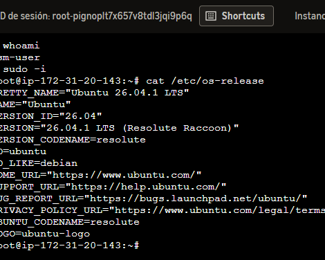

# AWS Systems Manager

This section documents my learning journey with AWS Systems Manager. AWS
Systems Manager helps you view, manage, and automate operations across AWS
resources at scale. It can run commands on individual instances or groups of
instances without requiring SSH or inbound security group rules.

## Prerequisites

Before getting started, make sure you have:

- An active AWS account
- An existing EC2 instance
- An IAM user with permission to use Systems Manager
- Amazon EC2 Systems Manager Agent (SSM Agent) installed and running on the
  instance
- Network access to AWS Systems Manager endpoints

> **Security note:** Use least-privilege IAM permissions and avoid attaching
> administrative policies to EC2 instances. Credentials on an EC2 instance
> should come from an IAM role attached to the instance, not from access keys
> stored on the instance.

## Creating an IAM role

Session Manager requires an IAM role to give the EC2 instance permission to
communicate with AWS Systems Manager.

1. Open the AWS Management Console.
2. In **IAM**, go to **Roles** and select **Create role**.
3. Choose **AWS service** as the trusted entity.
4. Select **EC2** as the use case.
5. Add the AWS-managed policy `AmazonSSMManagedInstanceCore`.
6. Enter a role name and, optionally, a description.
7. Create the role.

## Attaching the role to an EC2 instance

1. Open the **EC2** dashboard.
2. Select the EC2 instance.
3. Choose **Actions**.
4. Select **Security** and then **Modify IAM role**.
5. Select the IAM role created in the previous section.
6. Choose **Update IAM role**.

Wait for the instance to register with Systems Manager. The instance should
appear in **Fleet Manager** or in **Session Manager** under **Managed
nodes**.

## Starting a Session Manager session

Session Manager lets you connect to an EC2 instance through the AWS Management
Console without an SSH key or an open inbound SSH port.

1. Open **AWS Systems Manager**.
2. In the left navigation pane, select **Session Manager**.
3. Choose **Start session**.
4. Select the target instance.
5. Keep the default session document unless a specific configuration is
   required.
6. Choose **Start session**.

A browser-based terminal session will open:



You can now run commands in the instance terminal. For example:

```bash
whoami
hostname
```

## Verifying Systems Manager connectivity

From an EC2 instance terminal or AWS CloudShell, list the EC2 instances in the
configured AWS Region:

```bash
aws ec2 describe-instances
```

The command returns instance details in JSON format.

To verify that the instance is registered with Systems Manager, open
**AWS Systems Manager** and select **Fleet Manager**. The instance should
appear as a managed node when SSM Agent is running and the required permissions
and network access are available.

## AWS CloudShell

AWS CloudShell provides a browser-based terminal for running AWS CLI commands.
It uses temporary credentials associated with your current AWS identity, so
you do not need to configure access keys for standard CloudShell use.

CloudShell is available in supported AWS Regions. From the terminal, run:

```bash
aws ec2 describe-instances
```

The command shows the EC2 instances visible to the active AWS identity in the
selected Region.

> **Security note:** Do not paste access keys or session credentials into
> CloudShell or any terminal shared with other users.

## Additional resources

- [AWS Systems Manager documentation](https://docs.aws.amazon.com/systems-manager/)
- [Session Manager documentation](https://docs.aws.amazon.com/systems-manager/latest/userguide/session-manager.html)
- [AWS Systems Manager prerequisites](https://docs.aws.amazon.com/systems-manager/latest/userguide/systems-manager-prerequisites.html)
- [AWS CloudShell documentation](https://docs.aws.amazon.com/cloudshell/latest/userguide/welcome.html)
