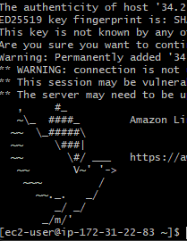

# AWS

## Amazon EC2

Amazon Elastic Compute Cloud (Amazon EC2) lets you launch and manage virtual
servers, called **instances**, in the AWS cloud.

### Amazon Machine Images (AMIs)

An Amazon Machine Image (AMI) is a template used to create an EC2 instance. It
includes an operating system and may include additional software. Choose an AMI
that suits your needs; availability and free-tier eligibility can vary by
region and AWS account.

### Launching an instance

When you launch an instance, you can configure a key pair and provide a **user
data** script:

- **Key pair:** AWS uses the key pair to authenticate SSH connections. You
  download and keep the private key file (for example, `my-key.pem`); AWS
  installs the matching public key on the instance. The private key is not a
  password, and you should never share it.
- **User data:** A script entered in the **User data** field can run during the
  instance's first startup. For example, on a Linux AMI that uses `dnf`, this
  script installs and starts the Apache web server:

  ```bash
  #!/bin/bash
  dnf install httpd -y
  systemctl enable --now httpd
  ```

  Package managers differ between operating systems and AMI versions. Check
  which package manager your chosen AMI uses.

After launch, find the instance and its public IP address in the EC2 console.


### Connecting to a Linux instance with SSH

Before connecting, make sure the instance is running, has a public IP address,
and its security group allows inbound SSH (TCP port 22) from your IP address.

In Git Bash or a terminal with SSH installed, run:

```bash
ssh -i "my-key.pem" ec2-user@<PUBLIC_IP>
```

Replace `my-key.pem` with the path to your private key file and `<PUBLIC_IP>`
with the instance's public IP address. The login name depends on the AMI:

- Amazon Linux: `ec2-user`
- CentOS: `centos`
- Ubuntu: `ubuntu`

The default login account is not the root account. The correct username depends
on the operating system image you selected.

If everything goes well, you will find this imagen when you do ssh conexion. 



## Troubleshooting SSH connections

Use the `-v` option to show connection details. Use `-vvv` for more detailed
diagnostic output:

```bash
ssh -vvv -i "my-key.pem" ec2-user@<PUBLIC_IP>
```

The output can help identify the cause of a connection problem. Common errors
include:

### Connection timed out

```text
ssh: connect to host <PUBLIC_IP> port 22: Connection timed out
```

Check that the instance is running and has a public IP address. Also check its
security group inbound rules, network routing, and any network firewall between
your computer and AWS. For safer access, allow SSH from your own IP address
rather than from all IP addresses.

### Permission denied (publickey)

```text
<USERNAME>@<PUBLIC_IP>: Permission denied (publickey).
```

Check that you are using the private key that matches the key pair selected
when the instance was launched, and that the username matches the AMI. For
example, `ec2-user` is commonly used for Amazon Linux, while CentOS commonly
uses `centos`.

### Could not resolve hostname

```text
ssh: Could not resolve hostname <HOSTNAME>: Name or service not known
```

Check that the host name or IP address is entered correctly. This error is
about resolving the host name; an incorrect SSH username typically causes an
authentication error instead.
