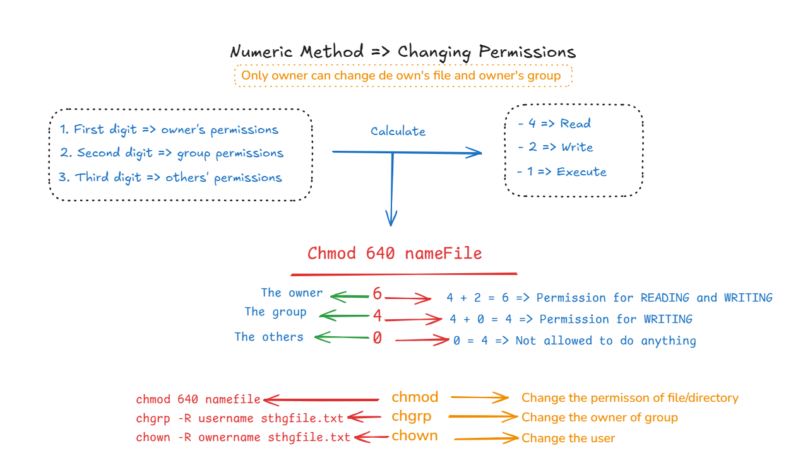

# CHANGE PERMISSION BY NUMERIC
### 🗒️ How you can change permission file using number?
Here you'll find a quick overview of how to change a file's permissions using numbers. I'll explain what each one means and how it works with this visual example.

