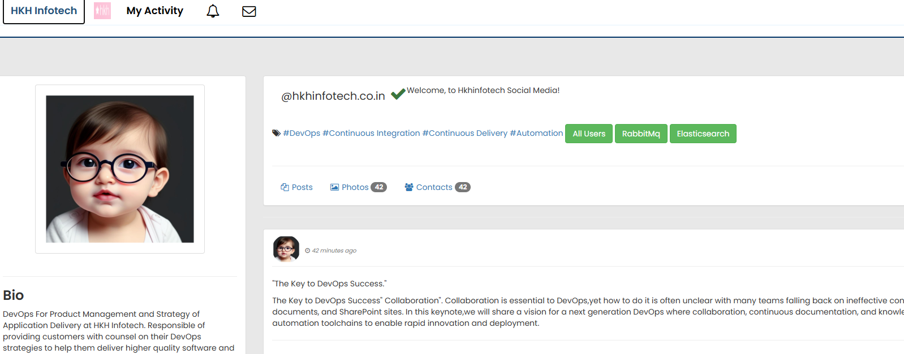

# Docker Fundamentals

This document explains the basic concepts of Docker in a simple and practical way. The goal is to help people understand the technology without needing advanced technical knowledge, while still showing the most common commands used in real projects.

## What is Docker?

Docker is a platform that allows applications to run in isolated environments called containers.

A container is like a lightweight virtual machine, but it is more efficient because it shares the system resources of the host machine instead of creating a full operating system for each application.

In simple terms:
- An image is the blueprint or recipe.
- A container is the running instance of that blueprint.

Docker is especially useful because it helps developers package an application and all its dependencies in one place. This makes the app run the same way in different environments, such as on a local computer, a server, or in the cloud.

## Why is Docker important?

Before Docker, applications often worked correctly on one machine but failed on another because of differences in:
- operating system versions
- installed libraries
- configuration files
- environment variables

Docker helps solve this problem by creating a consistent environment for the application.

Benefits of Docker:
- portability between environments
- faster testing and deployment
- easier collaboration between teams
- better scalability
- simpler environment setup

## Docker Hub

Docker Hub is a public registry where developers can find and share container images.

Website: https://hub.docker.com/

This is useful because instead of building everything from scratch, you can download officially maintained images for tools such as Nginx, MySQL, MongoDB, Redis, Node.js, and many others.

## Basic Docker concepts

### Image
An image is a read-only template that contains:
- the operating system layer
- application files
- dependencies
- runtime configuration

### Container
A container is a running instance of an image.

Think of it this way:
- image = recipe
- container = meal prepared from that recipe

### Volume
A volume is a special storage area used to keep data outside the container. This is useful because container data can be lost when the container is deleted.

### Network
Containers can communicate with each other through Docker networks. This allows services such as a database and an application to work together.

## Common Docker commands

### 1. Run a container

The following command downloads and runs the official `hello-world` image:

```bash
docker run hello-world
```

This command creates a container from the image and executes it.

### 2. List downloaded images

```bash
docker images
```

This shows the images stored locally on the machine.

### 3. List containers

```bash
docker ps -a
```

This shows all containers, including stopped ones. The `-a` flag means "all".

### 4. Pull an image

```bash
docker pull nginx
```

This downloads the `nginx` image from Docker Hub so it can be used locally.

### 5. Stop a container

```bash
docker stop container_name
```

### 6. Remove a container

```bash
docker rm container_name
```

### 7. Remove an image

```bash
docker rmi image_name
```

## Example: running Nginx in a container

The following command creates a container named `web01` and runs Nginx in the background.

```bash
docker run --name web01 -d -p 9080:80 nginx
```

Explanation:
- `docker run`: creates and starts a container
- `--name web01`: assigns a name to the container
- `-d`: runs the container in detached mode (background)
- `-p 9080:80`: maps the local port to the container port
- `nginx`: the image being used

Port mapping means:
- `9080` is the port on your computer
- `80` is the port inside the container

If you open the browser and go to `http://localhost:9080`, you are accessing the Nginx service inside the container.

## Inspecting a container

To check details about a container, use:

```bash
docker inspect web01
```

This command shows information such as:
- container ID
- network configuration
- assigned IP address
- environment variables
- ports
- mounted volumes

This is useful when you want to verify how the container is configured.

## Building an image from a Dockerfile

A Dockerfile is a text file that contains instructions for creating a Docker image. It defines what should be installed, which files should be copied, and how the application should run.

Example of a simple Dockerfile:

```dockerfile
FROM nginx:latest
COPY . /usr/share/nginx/html
```

To build the image from the Dockerfile, use:

```bash
docker build -t testimg .
```

Understanding the command:
- `docker build`: creates an image from a Dockerfile
- `-t testimg`: assigns a name to the image
- `.`: uses the current directory as the build context

## Running a container from a custom image

Once the image is built, it can be started with:

```bash
docker run -P -d testimg
docker ps
```

Explanation:
- `docker run`: creates and runs the container
- `-P`: publishes the ports declared in the Dockerfile
- `-d`: runs in the background
- `testimg`: the custom image we created earlier
- `docker ps`: lists running containers

## Managing Docker resources

As you work with Docker, containers and images can accumulate. It is important to remove unused ones to keep the environment clean.

### Stop multiple containers

```bash
docker ps
docker stop name1 name2 name3
```

### Remove images

```bash
docker images
docker rmi imageID imageID
```

Important difference:
- a container is a running instance
- an image is a reusable template

You usually stop and remove containers first, then delete unused images.

## Docker Compose

Docker Compose is a tool that helps manage multiple containers at the same time.

Instead of starting each container manually, you can define all the services of an application in a single file called `docker-compose.yml` and run them together with one command.

This is especially useful when an application has several parts, such as:
- a web application
- a database
- a cache server
- a message broker

### Why use Docker Compose?

Docker Compose makes container management easier because it allows you to:
- start all containers with one command
- define ports, environment variables, and volumes in one place
- keep the configuration organized
- recreate the same environment more quickly
- simplify teamwork and deployment

### Example of a Docker Compose file

```yaml
version: '3.8'
services:
  vprodb:
    image: vprocontainers/vprofiledb
    ports:
      - "3306:3306"
    volumes:
      - vprodbdata:/var/lib/mysql
    environment:
      - MYSQL_ROOT_PASSWORD=vprodbpass

  vprocache01:
    image: memcached
    ports:
      - "11211:11211"

  vpromq01:
    image: rabbitmq
    ports:
      - "15672:15672"
    environment:
      - RABBITMQ_DEFAULT_USER=guest
      - RABBITMQ_DEFAULT_PASS=guest

  vproapp:
    image: vprocontainers/vprofileapp
    ports:
      - "8080:8080"
    volumes:
      - vproappdata:/usr/local/tomcat/webapps

  vproweb:
    image: vprocontainers/vprofileweb
    ports:
      - "80:80"

volumes:
  vprodbdata: {}
  vproappdata: {}
```

### What does this file do?

This file defines multiple services:
- `vprodb`: database service
- `vprocache01`: cache service
- `vpromq01`: message broker service
- `vproapp`: application service
- `vproweb`: frontend or web service

Each service can have:
- an image
- environment variables
- exposed ports
- persistent volumes
- dependencies with other services

Note: Is you want more information about Vprofile in Docker: https://hub.docker.com/search?q=vprofile 

### Start the application with Docker Compose

```bash
docker compose up -d
```

This command does the following:
- reads the `docker-compose.yml` file
- creates or starts the defined containers
- runs them in the background
- sets up the network and storage configuration

This is the result of compose.yml; we can check the webapp's IP 192.168.56.82. We have a webapp.


### Stop the application

```bash
docker compose down
```

This stops and removes the containers created by Docker Compose.

```bash
docker system prune -a
```
This remove all unused containers, networks, images (both dangling and unused), unused build cache, and optionally, volumes.

### View running services

```bash
docker compose ps
```

This shows the status of the services defined in the file.

### View logs

```bash
docker compose logs
```

This helps troubleshoot problems by showing the output of each service.

## Docker Compose vs Docker run

If you run a single container, you can use `docker run` directly.

If your application needs several containers working together, Docker Compose is a better option because it organizes them in a single configuration file.

Example:
- use `docker run` for a single Nginx container
- use `docker compose` for a full stack with database, app, and cache

## Summary

Docker is a technology that allows applications to run consistently in isolated environments called containers.

In simple terms:
- Image = a prepared recipe
- Container = the running application
- Docker Compose = a way to manage all services of an application together

## Learning progress

This project helped me understand:
- how Docker images are created and used
- how containers run and communicate
- how to map ports and manage resources
- how to inspect containers and troubleshoot problems
- how to use Docker Compose to manage multi-service applications

