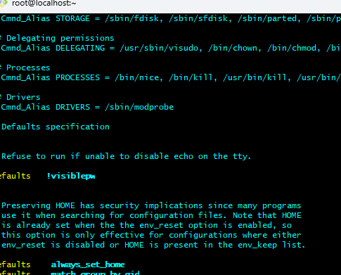
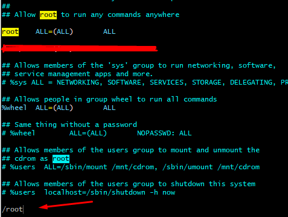
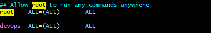
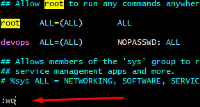
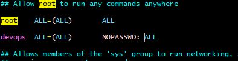
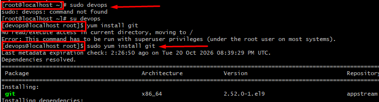
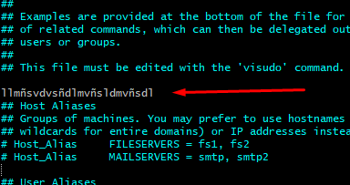
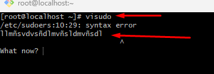
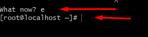

# What is the VISUDO command in Linux? 🧐

## :book: Description
 `Visudo` is a Linux command used to safely edit the `/etc/sudoers` configuration file.
 This file defines which users and groups can run commands with elevated privilages using `sudo`

## Why is `visudo` important?
Editting `/etc/sudoers` incorrectly can cause `sudo` to stop working. The `visudo` command helps prevent this by checking the configuration defore installing the changes.

## :lock_with_ink_pen: Why you need to use `visudo` instace of `vim` `nano`? 
You can use editors such as `vim` or  `nano` to edit regular text files. However, you should always use `visudo`to modify the sudoers configuration.

### Visudo provides two important protections: 
- ✅ **Validating the syntax**: Checks the configuration for syntax errors before installing the changes.
- 🔒 **Locking the file**: Helps prevent multiple administrator fom editing the sudoers file simultaneously.

Note: Users with unrestricted sudo privileges can usually execute commands as root. Grant these privileges only to trusted users.

### 🗃️ How to use visudo: 
Run as root user the following command in your terminal 

```bash
sudo visudo
#output: This opens the sudoers configuration file in the editor configured for your system.
```




### :person_in_tuxedo: How to Grant Sudo Privileges to a User:

In this example, I will grant sudo privilage to a user named `devops` as example.

1. **Open the sudoers file as root user**

```bash
sudo visudo
```
2. **Inside of the file, you need to find the word `root`, you can type `/root` like this.**



3. **Add a new line after `root` information as you can see in the imagen before.**

NEVER remove the line of the `root`. You can do it pressing the letter `o` if you have a cursor in this line. Then add this user.

**Extra information :magic_wand:** You can copy and paste the same line that it has root user. Pressing letter `yy` for coping and `pp` pasting where your cursor is.

In this example, I added user `devops` like this.




4.  **Save and exit**
Now, if you are using Vim:
- Press ESC to enter command mode 
- Type: `:wq` like this. 
- Press ENTER for saving and closing



So far, when you log as `devops`the system should asked for the password. 

5. **Set or Change the User's Password**

Granting sudo privileges does not create a user or set their password.

```bash
#For exmaple: Keeping the user `devops` as example
sudo passwd devops
```
Follow the prompts to enter and confirm the new password.

🪄 Trick: You can configure `NOPASSWD: ` to allow a user to execute matching sudo commands without entering a password.




## :arrow_forward: Testing time ##

In my test, I switched to the devops user and tried to install Git.

As you can see in the following picture, I was logged as root and changed to `devops` user, then I have tried to install `git`program but it said "You do not have permission for that". Then, when I used `sudo` and everything works perfectly.



## :ant: Trouble shooting ##

Sometimes, you may enter incorrect information, make spelling mistakes or any other kind of error; the result will show you the updated information and where the problem lies so that you can fix it.

In this case, I am going to simulate an error by adding random letters, as shown in the image.



After saving and closing,  the screen will show you the `syntax error...`.



To exit this error and return to the file, simply type `e` and press ENTER after the text `what now?`



The `/etc/sudoers` file will open again and you can remove the wrong letter and save and close it. 

:nerd_face: Fixing the error.